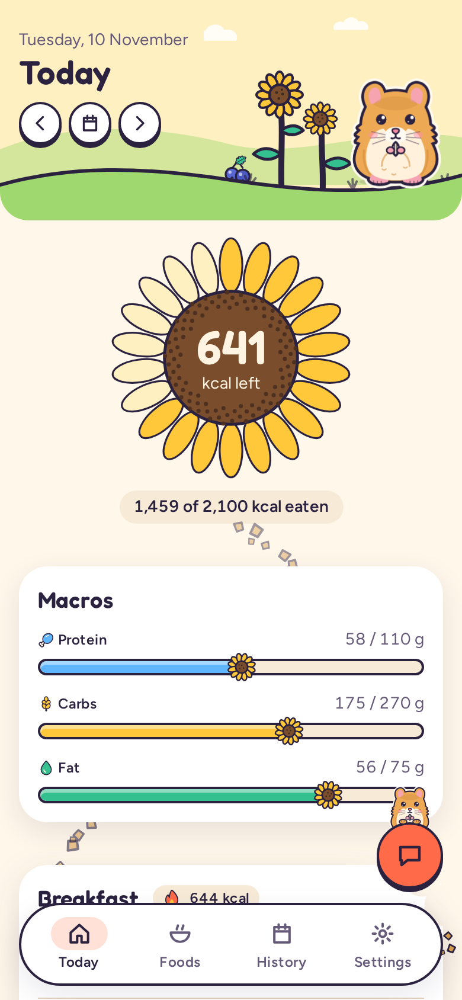
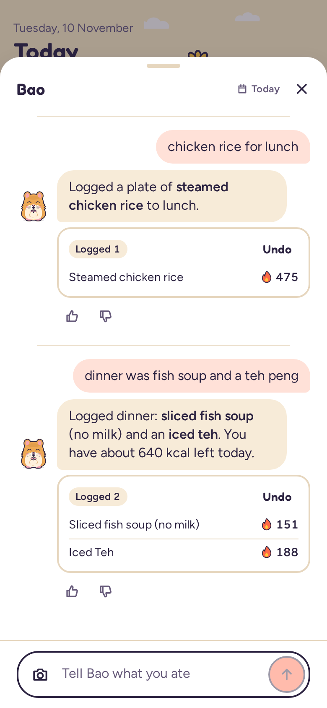
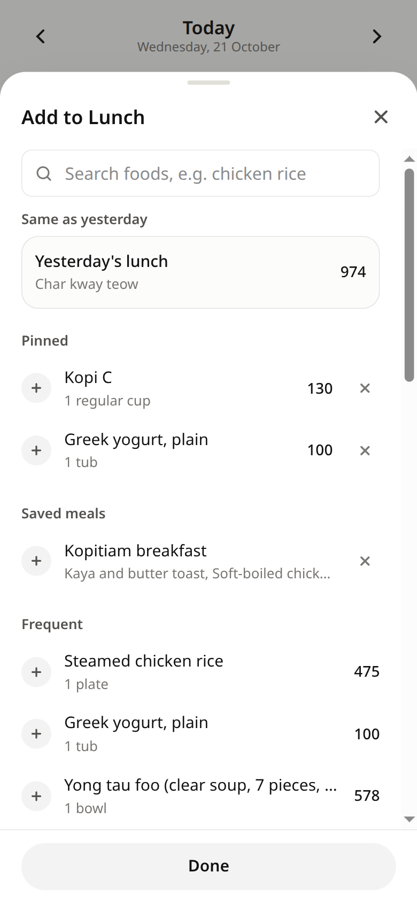
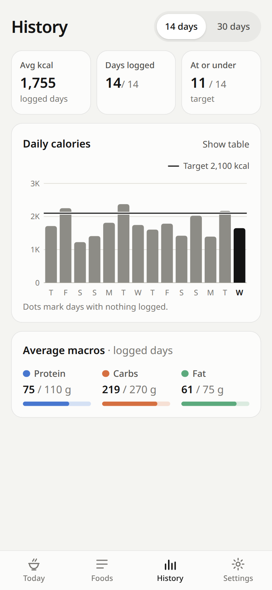
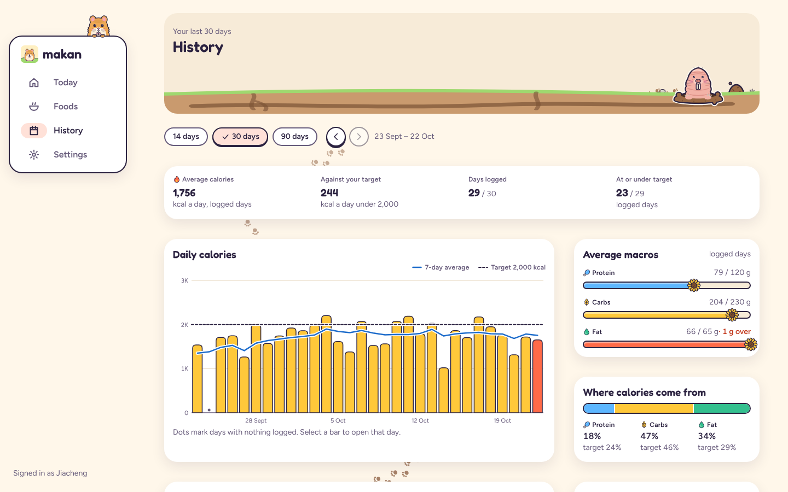

# Bao

Bao is a calorie and macro tracker for a household of two, built around Singapore food. You can search for a food and tap to add it, or just tell Bao the assistant what you ate:

> breakfast kopi c and kaya toast, lunch chicken rice

or send it a photo of your plate. Bao logs it straight away, and you can correct it by replying ("actually 2", "that was lunch").

You host it yourself. It runs as one Docker container, and you install it on your phone from the browser.

<p>
  
  
  
  
</p>
<p>
  
</p>

## What you get

- **Logging by meal.** Every entry goes under breakfast, lunch, dinner or snacks on a given day, so you can log a whole day at once in the evening.
- **Calories, protein, carbs and fat against your targets.** Fibre, sugar, sodium and saturated fat are recorded too.
- **Local food that's already there.** About 2,700 Singapore foods from the Health Promotion Board, hawker dishes and kopi orders included, at hawker portions. About 13,600 more generic foods from the USDA.
- **Your own foods.** Save the things you buy often, or snap a nutrition label and Bao saves it for you. Your own foods win when you're vague: "a bowl of yogurt" means your usual yogurt.
- **Quick adds.** Pinned foods, frequent and recent foods, saved meals, and "same as yesterday".
- **A chat with Bao.** Send text or up to six photos. It logs right away, and every reply has an undo button and a thumbs up or down. It can also change past days.
- **Two people, separate logs.** You share the food list, but each person has their own log, targets and quick adds.
- **A daily reminder** if you want one. It's a phone notification at the time you choose, and only when a main meal isn't logged yet. It works on Android in Chrome, and on iPhone (iOS 16.4 or later) once Bao is on your Home Screen.
- **History.** Averages, daily calories against your target, macros per day and where your calories come from. On a laptop it spreads out into a dashboard covering 14, 30 or 90 days.
- **Optional: connect it to Claude.** A read-only connector lets an assistant on claude.ai read your log and targets, for example to review your week.

The look comes from Burrow, a small design system shared with the household's other apps: plain cards and numbers, with Bao the hamster and friends living around them. The day's calories are a sunflower that opens a petal at a time. It follows your phone's light or dark mode.

## How good is the assistant?

It's tested against 91 cases: everyday text messages, follow-up corrections, nutrition labels, 29 real meal photos, and real mistakes it has made. Simple text logging is close to perfect. Judging portion sizes from photos is the hard part.

| model | cases passed | cost per case |
|---|---|---|
| Claude Haiku 5.5 (the default) | 83% | about $0.001 |
| Claude Sonnet 5.5 | 88% | about $0.015 |
| Claude Opus 5.5 | 93% | about $0.03 |

A typical message is answered in about 5 seconds. [evals/README.md](evals/README.md) shows what the cases are, where it still goes wrong, and how to run the tests yourself.

## What it costs to run

You pay Anthropic for the assistant. On the default model a message costs about a tenth of a cent, which comes to well under a dollar a month for two people. Settings shows this month's spend. To use a different model, set `AGENT_MODEL` and `AGENT_EFFORT` in `.env`.

## Set it up

You need:

- a machine that runs Docker with Compose
- a domain, with Caddy or another reverse proxy handling HTTPS
- [Pocket ID](https://pocket-id.org) for sign-in with passkeys
- an Anthropic API key

Steps:

1. **Create a sign-in client in Pocket ID.** Call it `bao` and give it both callback URLs:
   - `https://bao.example.com/auth/web/callback` (signing in from the browser)
   - `https://bao.example.com/oauth/callback` (the claude.ai connector)

   Limit it to a user group with just the two of you, and copy the client ID and secret.
2. **Fill in the settings.** Run `cp .env.example .env` and fill it in.
3. **Start it** with `docker compose up -d`. This uses the latest release. To stay on one version, set `BAO_TAG=1.2.0` in `.env`.
4. **Point your proxy at it.** For Caddy:

   ```
   bao.example.com {
       reverse_proxy <host>:8000
   }
   ```

5. **Sign in** with your passkey and set your daily targets in Settings. On your phone, use "Add to Home Screen", open Bao from there, and turn on the reminder if you want it.

### Backups and updates

Everything Bao keeps is in the `makan-data` Docker volume, mounted at `/data`. (The volume is still named after the app's old name, makan.)

| In the volume | What it is |
| --- | --- |
| `app.sqlite` (and `-wal`, `-shm`) | The live database. Don't copy these while Bao runs; a copy can be corrupt. |
| `backup/app.sqlite` | A consistent snapshot of the database, rewritten every day at 3am. |
| `files/` | Meal photos. Written once, never changed. |
| `secret`, `vapid.json`, `mcp/` | Keys for sign-in and reminders, and which Claude connectors are connected. |

Point your backup tool at the volume and leave out `app.sqlite*` at its top level. To restore, stop Bao, put the files back, and run:

```bash
docker compose run --rm bao npx warren restore /data/backup/app.sqlite
```

To update, run `docker compose pull && docker compose up -d`. If a release needs anything done by hand, its release notes say so under **Deploy actions**.

**Coming from an earlier release (the Python version)?** The database moved to a new format. With the new image, run the import once, then start Bao:

```bash
docker compose run --rm bao node dist/importLegacy.js /data
```

It reads the old `makan.db` and photos and leaves them in place; delete them once you're happy. In `.env`, replace `OIDC_CONFIG_URL` with `OIDC_ISSUER` (the same address without `/.well-known/openid-configuration`), and in Pocket ID change the connector's callback URL from `/auth/callback` to `/oauth/callback`. Everyone signs in once more, and the claude.ai connector has to be removed and added again.

### Connect Claude (optional)

Sign in to Bao in a browser first. Then in claude.ai go to Settings → Connectors → Add custom connector and enter `https://bao.example.com/mcp`. Claude can then read your profile, daily totals, food log and food list. It can't change anything, and each person only sees their own data.

## Food data

The food lists are saved in the repo under `data/reference/`, so Bao never contacts HPB or the USDA while it runs. To refresh them, run these and restart Bao:

```bash
uv run --no-project python -I scripts/fetch_sgfoodid.py   # about 5 minutes
uv run --no-project python -I scripts/fetch_usda.py
```

Past entries stay linked to their foods. `data/reference/aliases.json` maps hawker shorthand to foods, for example "teh peng" to Iced Teh.

### Attribution

Contains information from Singapore Food Insights Database (SG FoodID) accessed on 2026-10-21 from Health Promotion Board which is made available under the terms found at https://pphtpc.hpb.gov.sg/web/sgfoodid. The information contained within this dataset is provided on an "as-is" basis. The data, including but not limited to nutritional information, is subject to inherent limitations. No warranty or representation is made as to the accuracy or completeness of the data contained herein. USDA FoodData Central data is public domain. The app shows both notices on its Settings page.

## For developers

```bash
cd server && npm ci
npm run dev                                 # the app on :8000, with a name picker instead of Pocket ID
npm test                                    # server tests
cd ../web && npm install && npm run dev     # live-reloading web app, talks to :8000
npm run check && npm run build              # check and build the web app
```

Never set `DEV_LOGIN=true` on a server. Put `ANTHROPIC_API_KEY` in your environment to use the assistant locally. To build the image from your own checkout, run `docker compose up -d --build`.

Where things are:

- `server/`: the backend in TypeScript, on [Warren](https://github.com/theepicflyer/warren), the framework our household's apps share. It holds the food and log rules, the assistant's prompt and tools (`src/agent/`), and its test cases (`evals/`)
- `web/`: the SvelteKit app; `web/src/lib/burrow/` is the design system
- `data/reference/`: the food lists, and `scripts/` builds them
- `evals/`: how the assistant is tested, with the photos
- `docs/screenshots/`: the screenshots above, from a demo account with made-up meals

### Reviewing the assistant's mistakes

Bao keeps each reply's rating, any error, and the app version that made it. It also keeps a record whenever someone fixes by hand an entry the assistant logged. To collect the turns worth a look (thumbs down, failed, or fixed by hand) into one file:

```bash
docker compose exec bao node dist/exportFlagged.js --db /data/backup/app.sqlite --since 2026-11-01 --format markdown --out /data/flagged.md
```

It only reads the database, and reads the daily snapshot rather than the live one.
