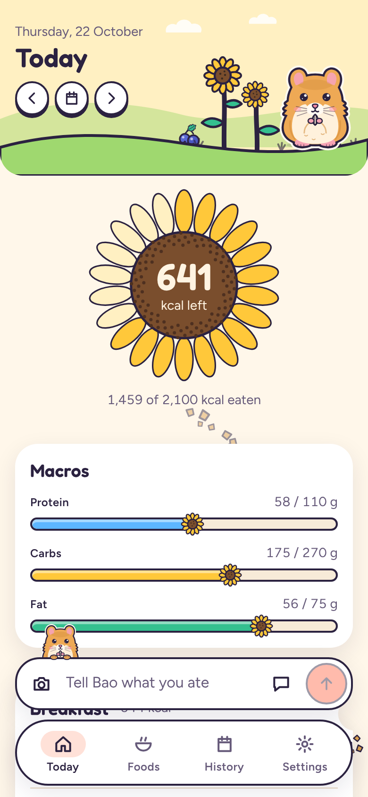
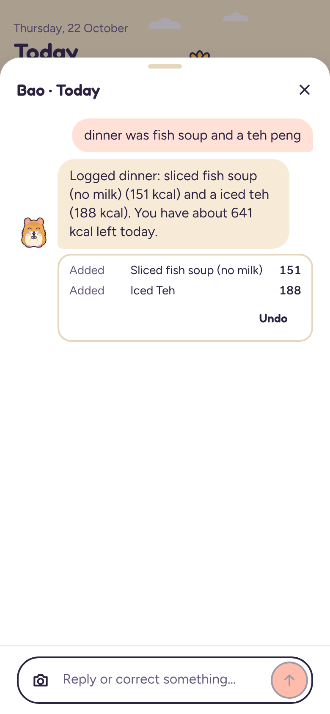
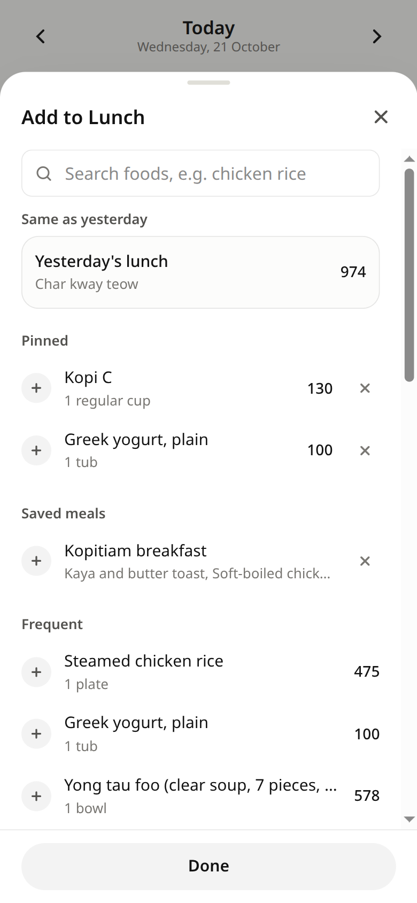
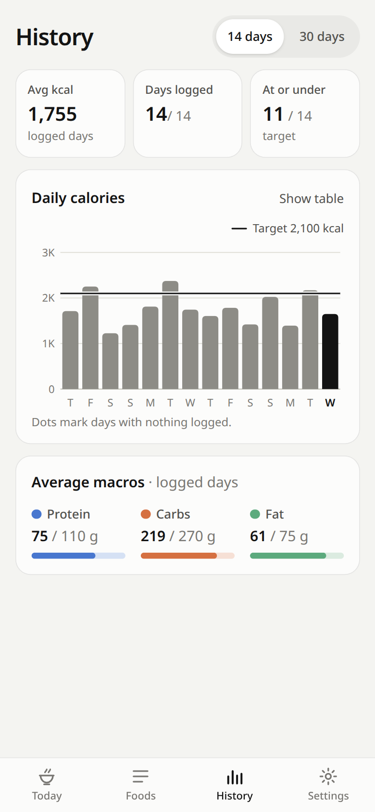
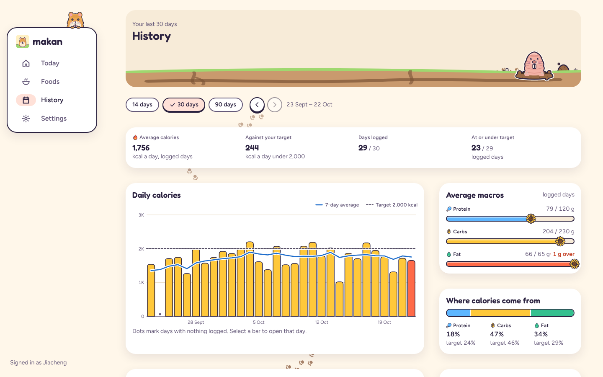

# makan

A self-hosted calorie and macro tracker for a two-person household in Singapore. You log food by meal, either by searching and tapping, or by telling Bao, the assistant, what you ate ("breakfast kopi c and kaya toast, lunch chicken rice…") or sending it a photo. It runs as one Docker container behind your reverse proxy, signs in through Pocket ID, and installs on a phone as a PWA.

<p>
  
  
  
  
</p>
<p>
  
</p>

## What it does

Each entry belongs to a date and a meal (breakfast, lunch, dinner or snacks), since most days get logged in one go at night. Calories, protein, carbs and fat are tracked against daily targets, and fibre, sugar, sodium and saturated fat are stored as well.

Both people search the same food database but see only their own log, targets and quick adds. The foods come from three places:

- SG FoodID, from the Health Promotion Board: about 2,700 items, including hawker dishes, kopi and teh, and local snacks at typical hawker portions.
- USDA FoodData Central: about 13,600 generic ingredients and Western foods.
- Ours, the household's own foods, such as the yogurt you always buy. An Ours food can claim generic words as aliases, so "a bowl of yogurt" means your yogurt unless you name another one.

Quick adds cover pinned items, frequent and recent foods, saved meals and "same as yesterday".

The assistant (Claude) turns a text dump or a meal photo into entries, applies them straight away, and fixes them when you reply ("actually 2", "that was lunch"). It can also edit past days and read a nutrition label into an Ours food. Each of its replies has an undo.

The look comes from Burrow, the household's shared design system (also used by the money app): plain cards and numbers, with Bao the hamster and friends living around them. Bao is also the assistant you chat with. Calories, protein, carbs and fat each have a symbol (a flame, a drumstick, an ear of wheat and a drop) used everywhere they appear. Each screen has its animal's home as a header, the day's calories are a sunflower that opens a petal at a time, logged meals get a bite out of the corner, and a trail of crumbs or footprints winds down each screen behind the cards to the next thing to do. It follows the phone's light or dark setting.

It also works in a desktop or laptop browser. From 1024px wide the bottom nav becomes a side rail and screens spread into columns. History becomes a dashboard: summary figures, daily calories with a 7-day average, macros per day against their targets, where the calories come from, the average by weekday, and a sortable table of every day with all its nutrients. You can view 14, 30 or 90 days and step back through earlier periods, and selecting a bar or a row opens that day.

A read-only MCP endpoint at `/mcp` lets another Claude agent, such as a fitness analyst on claude.ai, read your log, daily totals and targets. Whoever signs in sees only their own data.

## Deploy

You need Docker with Compose, a domain behind Caddy (or another TLS proxy), a Pocket ID instance and an Anthropic API key.

1. In Pocket ID, create an OIDC client named `makan` with both callback URLs:
   - `https://makan.example.com/auth/web/callback` (browser sign-in)
   - `https://makan.example.com/auth/callback` (the MCP connector's OAuth)

   Restrict it to a user group that holds just the two of you. Copy the client ID and secret.
2. Run `cp .env.example .env` and fill it in. You can leave `SESSION_SECRET` empty: makan generates one on first start and keeps it in the data volume.
3. Start it with `docker compose up -d --build`. The first start loads the food database, which takes a few seconds.
4. Add a Caddy site:

   ```
   makan.example.com {
       reverse_proxy <host>:8000
   }
   ```

5. Open the site, sign in with your passkey, and set your daily targets in Settings. On a phone, use "Add to Home Screen" to install it.

All state is in the `makan-data` volume: the SQLite database, meal photos, and the OAuth store behind the MCP connector. Back up that volume. To update, run `git pull && docker compose up -d --build`.

### Connect the analyst (claude.ai)

In claude.ai, go to Settings → Connectors → Add custom connector and enter `https://makan.example.com/mcp`. Sign in to makan in a browser at least once before you connect, because the connector only reads an existing account. The tools are `get_profile`, `get_daily_totals`, `get_food_log`, `search_foods` and `list_household_foods`. All of them are read-only.

## The assistant and its cost

The assistant uses `claude-haiku-5-5` at `low` effort by default (`AGENT_MODEL`, `AGENT_EFFORT`). Prompt caching is on. The system prompt and tools are cached across both users, and each conversation's history is cached from one turn to the next. Settings shows this month's assistant spend.

`evals/` checks the assistant against 43 cases: text dumps in Singlish, household-food defaults, follow-up edits, edits to past days, nutrition labels, and real meal photos. Each case is graded on the database it leaves behind. In the latest run, Haiku at low effort passed 97% of them for about $0.0006 per message, which comes to well under a dollar a month for two people. A typical message updates the log in about 3 seconds, and a follow-up edit in about 1.5. [evals/README.md](evals/README.md) has the full results and how to rerun them.

## Food data

The reference data is a snapshot committed under `data/reference/`, so the app never calls HPB or USDA at runtime. To refresh it:

```bash
uv run --no-project python -I scripts/fetch_sgfoodid.py   # ~5 min; HPB allows 60 requests/min
uv run --no-project python -I scripts/fetch_usda.py
```

Then restart the app. Reference foods keep their ids across reloads, so old entries stay linked. `data/reference/aliases.json` maps hawker shorthand to SG FoodID items, for example "chicken rice" to Steamed chicken rice and "teh peng" to Iced Teh.

### Attribution

Contains information from Singapore Food Insights Database (SG FoodID) accessed on 2026-10-21 from Health Promotion Board which is made available under the terms found at https://pphtpc.hpb.gov.sg/web/sgfoodid. The information contained within this dataset is provided on an "as-is" basis. The data, including but not limited to nutritional information, is subject to inherent limitations. No warranty or representation is made as to the accuracy or completeness of the data contained herein. USDA FoodData Central data is public domain. The app shows both notices on its Settings page.

## Development

```bash
uv sync
DEV_LOGIN=true uv run uvicorn makan.main:app --reload --port 8000   # API + built web app
cd web && npm install && npm run dev                                  # Vite dev server, proxies to :8000
uv run pytest                                                         # backend tests
cd web && npm run check && npm run build                              # type-check and build the web app
```

`DEV_LOGIN=true` replaces Pocket ID with a name picker. Never set it on the server. Put `ANTHROPIC_API_KEY` in `.env` to use the assistant locally.

Layout:

- `src/makan/`: the FastAPI app (`main.py`, `api.py`, `auth.py`), the food and log logic (`foods.py`, `log.py`), the agent (`agent/`), the MCP server (`mcp_server.py`), and Alembic migrations.
- `web/`: the SvelteKit PWA, built to `web/build` and served by the backend. `web/src/lib/burrow/` holds the Burrow design system's tokens, styles and drawings.
- `data/reference/`: the food snapshot. `scripts/` holds the scripts that build it.
- `evals/`: the agent eval cases, runner and report.
- `docs/screenshots/`: the screenshots above, taken from a demo account with made-up meals.
