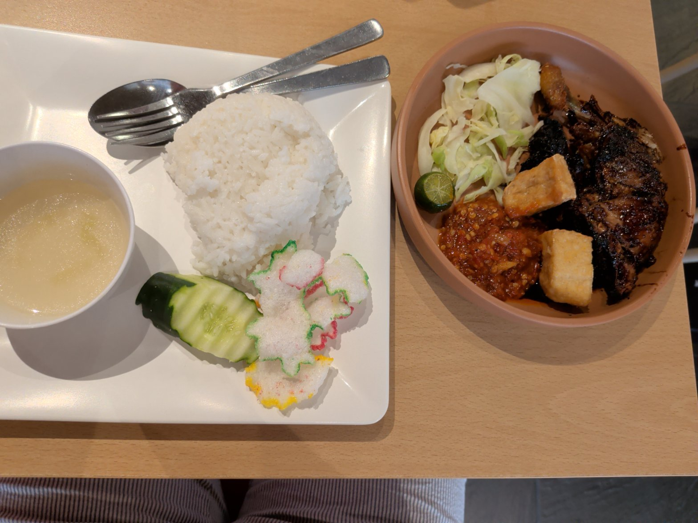
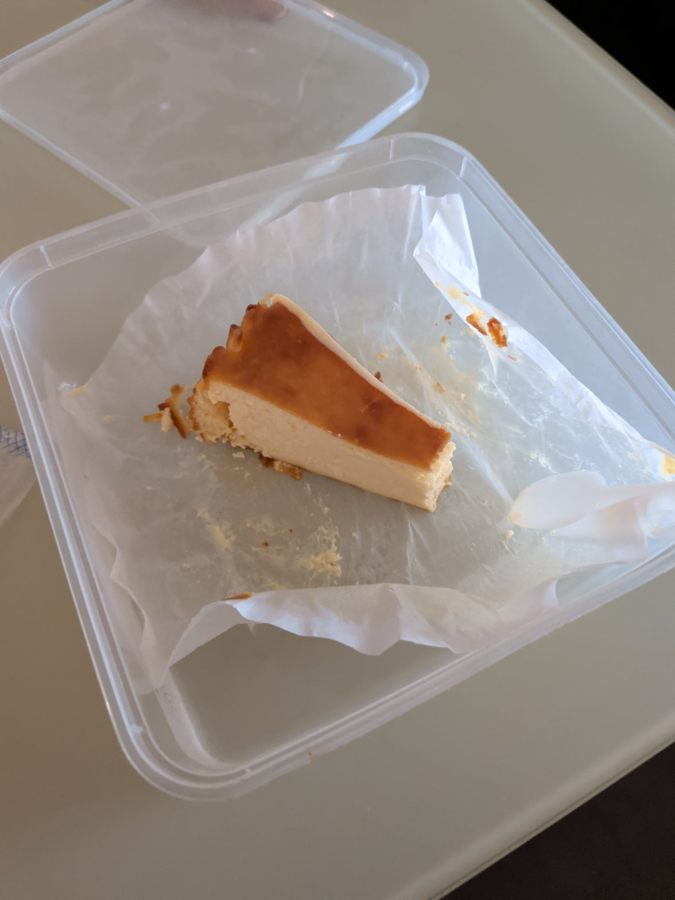
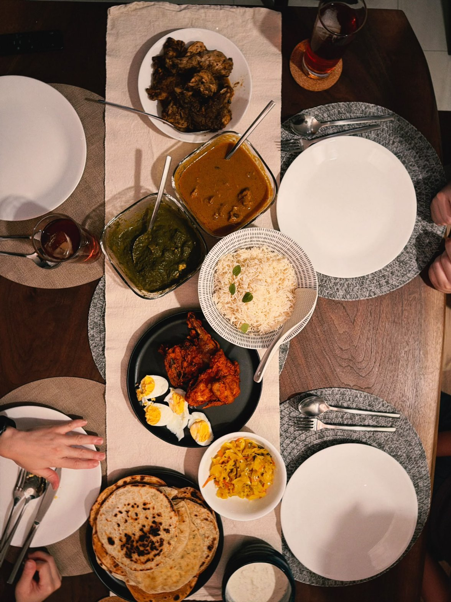

# How well does Bao log food?

This folder tests Bao the assistant on the jobs people actually give it: a day's meals typed in one go, a correction, a nutrition label, a photo of lunch. Each test, called a case, sends real messages to Claude through the same code the app uses, then checks what ended up in the food log. Did it pick the right foods, the right meal and day, a sensible portion? Did it leave alone anything it shouldn't touch?

Everything here is public, photos included, so you can run the tests yourself and should get similar numbers.

## Results

91 cases, run on 2026-11-11 at low effort. Haiku ran each case three times, Sonnet twice, Opus once.

| model | all cases | everyday text | real mistakes | photos | photo calories off by | cost per case |
|---|---|---|---|---|---|---|
| Claude Haiku 5.5 (Bao's default) | 83% | 97% | 73% | 70% | 12% | $0.0010 |
| Claude Sonnet 5.5 | 88% | 100% | 82% | 74% | 13% | $0.0146 |
| Claude Opus 5.5 | 93% | 100% | 89% | 88% | 10% | $0.0291 |

What the columns mean:

- **all cases**: the share of cases where every check passed, give or take about 5 points.
- **everyday text**: 30 made-up messages of the kind people send every day.
- **real mistakes**: 46 cases built from times Bao got something wrong in real use. They are hard on purpose.
- **photos**: 34 real photos of meals and nutrition labels.
- **photo calories off by**: the typical gap between the calories Bao logged for a meal photo and a reference estimate (the median).

All three models answer in about the same time: about 5 seconds for a typed message, 7 to 8 seconds for a photo.

### What changed

On 2026-11-11 Bao's instructions were reworked against the failures in this set. Haiku went from 69% to 83%, and from 44% to 73% on the real mistakes, with no loss on the cases it already got right and no change in cost.

- Each message now tells Bao today's date, yesterday's date and which of them the app is showing, so "yesterday" no longer goes back two days. A meal photo sent while the app shows an earlier day is logged today.
- What the user says about size beats the database's serving: "half a bowl", "a little slice", "a very big portion".
- Shared meals count only the user's share, and "split into 4" applies to every dish.
- A dish served in parts is still that dish (roasted chicken rice with the chicken on its own plate), and café drinks aren't matched to instant mixes.
- A correction changes the entry that's there, including when a label photo arrives for something already logged.
- "Save this meal as X" saves the whole meal, sides included.
- Search marks a result as the local meaning of a word ("naibai" is the vegetable), and "naibai", "maggi" and "coconut rice" were added to the shorthand list.

## What gets tested

**Everyday text (30 cases, made up).** For example:

- A whole day typed in hawker shorthand: "teh c siew dai", "milo peng", "supper ice kachang".
- Counts and weights: "10 sticks of chicken satay and half a ketupat", "200g grilled chicken breast".
- Your own foods: "a bowl of yogurt" should use the household's yogurt, but "Fage greek yogurt" should not.
- Corrections: "actually it was a large plate, make it 1.5", "make it siew dai" or "oh it was roasted chicken rice, not steamed" has to change the entry that's already there, not add a second one.
- Dishes the database doesn't have: "unagi fried rice" must include the eel, not get logged as plain egg fried rice.
- A question ("how much protein have I had today?") must not change anything.

**Real mistakes (46 cases).** Every time Bao got something wrong in real use, it became a case, with the original message. Some are rewritten with made-up meals to test the same pattern again. For example:

- "steamed chicken rice for dinner yesterday", sent when the app was already showing yesterday, went back two days.
- "it's a very big portion" made the portion smaller.
- "split into 4 portions" was never applied.
- "tau pok" (fried bean curd) was searched and came back as a poke bowl.
- "half a bowl of briyani" was logged as half of a large restaurant plate.

**Photos (34 cases, real).** Every photo sent to Bao in its first weeks of use: hawker plates, cai fan, restaurant sets, home cooking, a shared dinner, and nutrition labels. Labels must be saved exactly. Meals are checked for their main parts and for a total within about ±30% of a reference estimate.

## Three photos from the set

<table>
<tr>
<td width="33%"></td>
<td width="33%"></td>
<td width="33%"></td>
</tr>
<tr>
<td valign="top"><b>"ayam bakar"</b><br>Should log the chicken, rice and sides, about 870 kcal.<br><b>Passes on every model.</b></td>
<td valign="top"><b>"little slice of cheesecake"</b><br>Should be about 140 kcal. Haiku logs a bigger slice; Sonnet gets it right.<br><b>Fails on Haiku.</b></td>
<td valign="top"><b>"my dinner, its all indian food and the drink is pokka green tea"</b><br>The table was shared by four, so one share is about 1,040 kcal. Bao now counts a share, but usually guesses the table was for two.<br><b>Still fails most of the time.</b></td>
</tr>
</table>

## Where it still goes wrong

On Haiku, these still fail most of the time:

- a shared table of dishes, and "the rest was split into 4" for that dinner
- a home portion smaller than a standard serving (a little slice of cheesecake, pancakes)
- unagi hidden in home-made fried rice, read as mushroom
- roasted chicken rice photographed as rice and chicken on separate plates, logged as plain rice
- "egg tofu" matched to the database's steamed egg with tofu
- a household food the user asks to change, where Bao changes the log entry instead
- a fried chicken drumlet and fried pork, matched to the wrong cuts

Sonnet and Opus get most of the photo ones right. Opus got the shared table once; every model still misses "the rest was split into 4".

## Run it yourself

Every run except `--dry-run` calls the Anthropic API and costs money: about $0.09 for the whole set on Haiku, about $2.70 on Opus. Put `ANTHROPIC_API_KEY` in `.env` first.

```bash
uv run python -m evals.run --dry-run                                        # check every case, free
uv run python -m evals.run --model claude-haiku-5-5 --effort low --reps 2   # everything, twice
uv run python -m evals.run --tags photo --name haiku-photos                 # just the photos
uv run python -m evals.run --cases prod_p23_little_cheesecake --name try    # one case
uv run python -m evals.report                                               # summary table
```

Results go to `evals/results/<name>/`: a graded row per case in `results.jsonl`, each full conversation in `traces/`, and each case's final database in `dbs/`. If a run stops halfway, run the same command again and it picks up where it left off. `evals.report` writes a summary of every run to `evals/results/summary.md`.

More options:

- `--tags` runs every case that has any of the listed tags, such as `text`, `photo`, `label`, `regression` or `baseline`.
- `--cases` takes a comma-separated list of case ids.
- `--model` and `--effort` choose the Claude model and effort level.
- `--reps` runs each case more than once.
- `--no-cache` turns prompt caching off.
- `--regrade` grades a saved run again without calling the API.

## How the cases work

The cases are in two files:

- `cases.py`: 45 made-up cases, mostly typed messages.
- `prod_cases.py`: 46 cases from real use, including every photo case. The photos are in `photos/`. Each case keeps the real message, the household's own foods at the time and the log entries the message referred to. Dates are moved five weeks earlier, so weekdays still match what the message says.

`spec.py` defines what a case can say. Each case starts from a fresh copy of the food database and can add:

- `ours`: household foods, and `entries`: log entries that already exist before the message.
- `now` and `log_date`: when the message is sent and which day the app is showing. These are separate because people often log yesterday.
- `msgs`: one or more messages, each with optional photos.

Then it checks:

- `expect`: the entries that should be in the log afterwards, each with a pattern for the name and optionally a meal, date, calorie range or household food. They must match one to one, so an extra or duplicate entry fails. Photo meals may be split into any number of parts.
- `total_kcal`: a calorie range for the day or one meal. `ref_kcal` is the reference behind the "calories off by" figure.
- `forbid`: names that must not appear, such as "poke" in the tau pok case.
- `foods`: household foods that should exist afterwards, such as a saved label with its exact values.
- `reply_forbid`, `max_tool_calls`, `max_tool_errors`: limits on the reply and on how many steps Bao takes.

Tags say what kind of case it is: `text`, `photo`, `meal`, `label`, `edit`. `regression` marks a case Bao got wrong in real use, and `baseline` a real case it got right, so a change that fixes one mistake but breaks something that worked shows up. Other tags name the pattern, such as `stale_date`, `split`, `near_name` or `small_portion`.

Photo references are a reviewer's estimate from the photo, not weighed meals. Treat the calorie figures as approximate.

## Earlier results

These ran on an older version of the test set, so they aren't comparable with the table above. They're kept because they explain Bao's current settings.

<details>
<summary>Effort levels and prompt caching (2026-10-21)</summary>

43 cases, mostly typed messages, each run twice.

| model, effort | passed | cost per message |
|---|---|---|
| Haiku 5.5, low | 97% | $0.0006 |
| Haiku 5.5, medium | 97% | $0.0006 |
| Haiku 5.5, high | 97% | $0.0007 |
| Haiku 5.5, low, no prompt caching | 98% | $0.0018 |
| Opus 5.5, low (typed cases only) | 100% | $0.0138 |

- Higher effort bought no accuracy and made the slowest messages slower, so Bao uses low.
- Prompt caching cuts the cost by about two thirds. The instructions and tools are shared by both users, and each conversation is cached from one message to the next.
- A typed message changed the log in about 3 seconds, and a follow-up edit in about 1.5.
- Four prompt changes raised Haiku from 77–85% to 97%: treat messages about food already logged as edits, log the likeliest reading and say what was assumed instead of asking, keep follow-ups in the same meal, and save a new product as a new household food instead of overwriting the old one.

</details>

<details>
<summary>Working out photo portions in grams (2026-10-27)</summary>

Bao was changed to estimate each part of a photo in grams before choosing a food, judging size from the plate, bowl, cutlery and piece counts, and allowing for what the photo hides (rice under toppings, oil, gravy). On 27 photo cases, Haiku at low effort, run twice:

| | passed | meal total off by (mean) |
|---|---|---|
| before | 51 of 54 | 13.9% |
| after | 53 of 54 | 11.9% |

It helped most with plates the database has as a set with different parts. A nasi lemak with curry-leaf chicken had been logged as the database's chicken wing set. It is now split into rice plus an estimate for the chicken.

</details>
